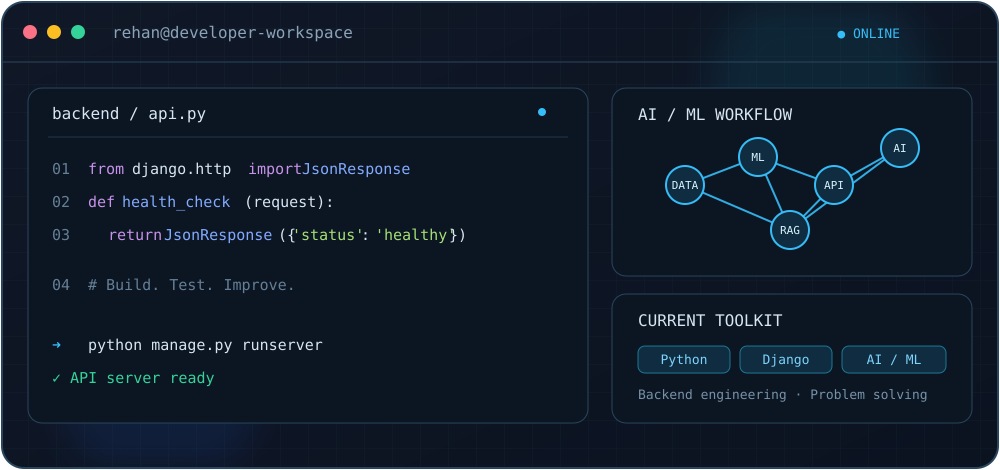

 <table>
  <tr>
    <td width="29%" align="center" valign="middle">
      
      <h2>Rehan Shaikh</h2>
      
Python Developer India 🇮🇳

      

        <a href="https://github.com/Rehan-070">GitHub</a> ·
        <a href="https://www.linkedin.com/in/rehan-shaikh-5754b533a">LinkedIn</a> ·
        <a href="mailto:rehan0rc0@gmail.com">Email</a>
      

    </td>
    <td width="71%" valign="middle">
      <h1>Hi, I'm Rehan.</h1>
      

        I work primarily with Python, building backend applications and exploring practical uses of AI.
      

      

        My current interests include:
      

      <ul>
        <li>Backend development with Django and REST APIs</li>
        <li>Machine learning and computer vision</li>
        <li>Generative AI and AI-powered applications</li>
        <li>Data structures, algorithms and problem solving</li>
      </ul>
      
    </td>
  </tr>
</table>

---

## Technologies

  

---

## Problem Solving

<table>
  <tr>
    <td align="center" width="50%">
      
       
      <a href="https://leetcode.com/u/REHAN_001/">LeetCode Profile</a>
    </td>
    <td align="center" width="50%">
      
       
      <a href="https://codeforces.com/profile/Rehan-3618">Codeforces Profile</a>
    </td>
  </tr>
</table>

  

---

## GitHub Activity

  

---

  Interested in backend engineering, AI and solving interesting problems.

